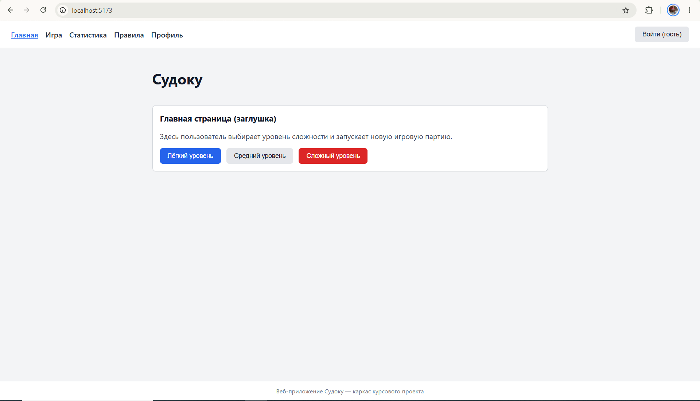
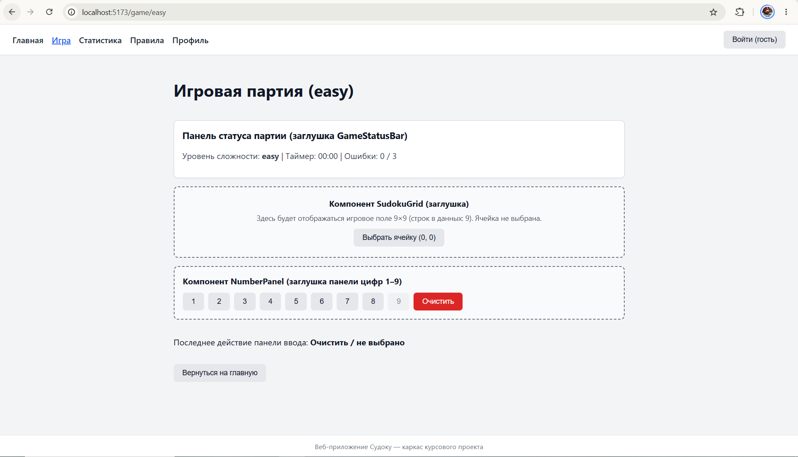

# 🧩 Веб-приложение Судоку (Курсовой проект — каркас MVP)

Монорепозиторий на базе React 19, TypeScript и Vite, содержащий библиотеку общих UI-компонентов (`ui-library`) и клиентское приложение (`frontend`) с настроенным роутингом и заглушками страниц.

Документация проекта:
* [Архитектурные требования](./architecture.md)
* [Функциональные требования к MVP](./mvp.md)

## 📸 Скриншоты работы приложения




## 🚀 Инструкция по запуску

Поскольку `frontend` использует собранный пакет `@sudoku-app/ui-library`, сначала необходимо установить зависимости и собрать библиотеку.

### 1. Сборка библиотеки `ui-library`
```bash
cd ui-library
npm install
npm run build
```

### 2. Запуск приложения `frontend`
```bash
cd ../frontend
npm install
npm run dev
```
*(При необходимости сетевого доступа используйте `npm run dev -- --host`.)*

Приложение откроется по адресу `http://localhost:5173/`.

## 📜 Доступные скрипты

Одинаковы для `ui-library` и `frontend`:

* `npm run dev` — запуск в режиме разработки.
* `npm run build` — проверка типов (`tsc -b`) и сборка Vite.
* `npm run lint` — проверка кода ESLint.
* `npm run lint:fix` — автоматическое исправление замечаний ESLint.
* `npm run test` — запуск тестов Jest.
* `npm run test:coverage` — запуск тестов с отчётом о покрытии кода.